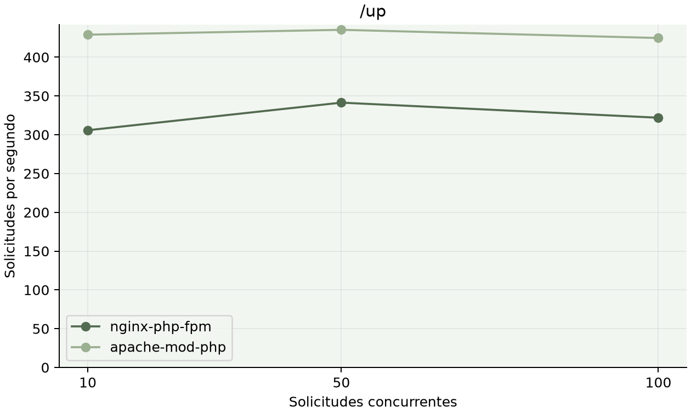
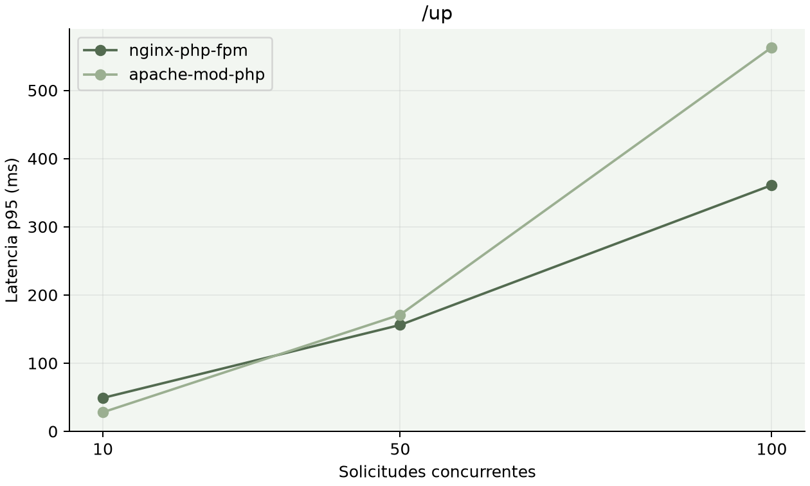
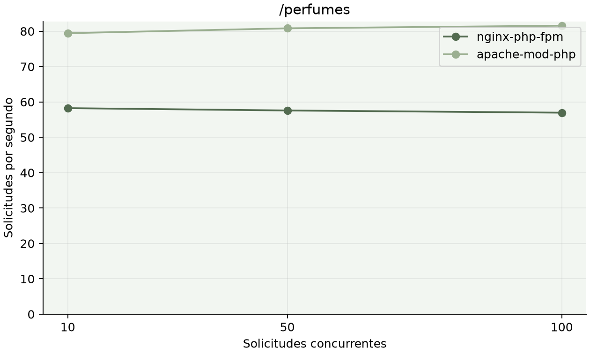
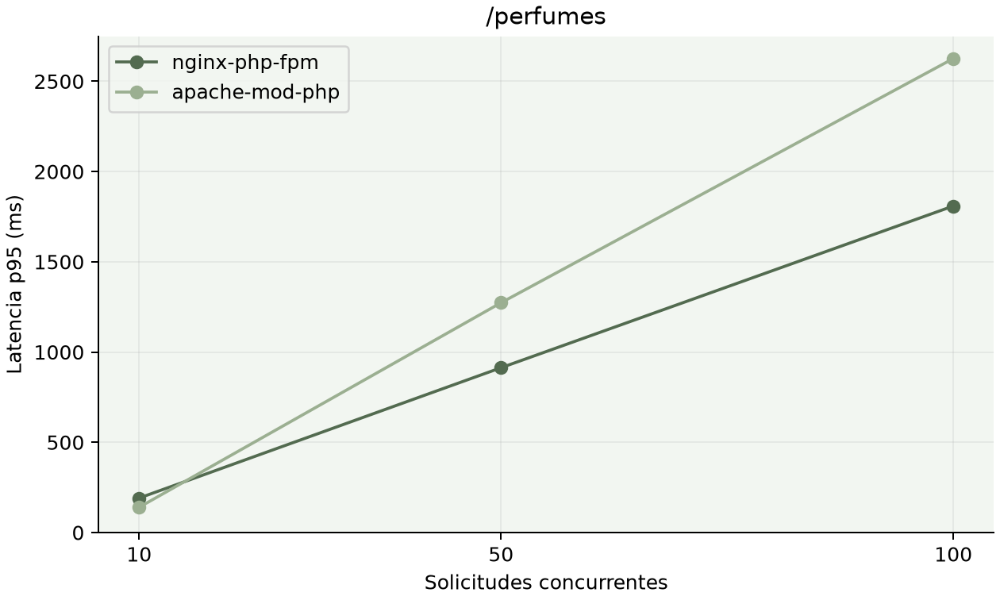
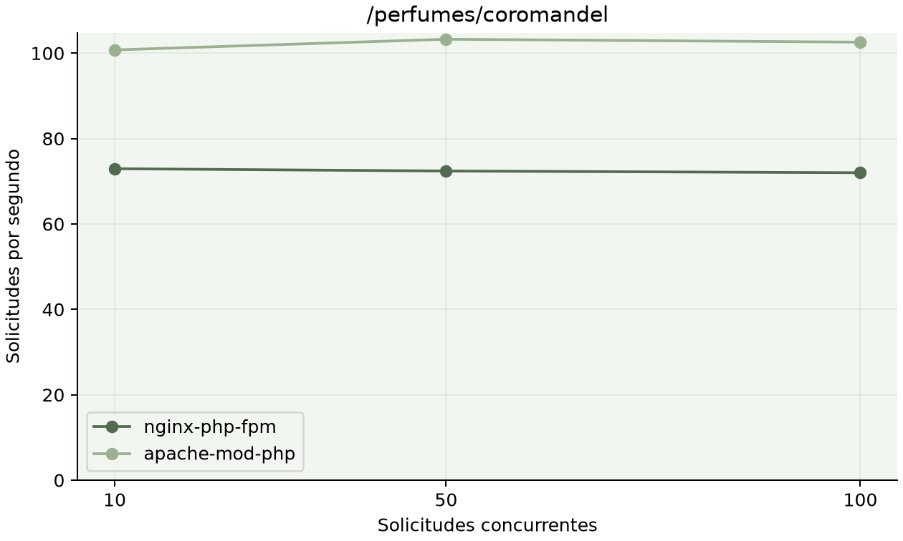
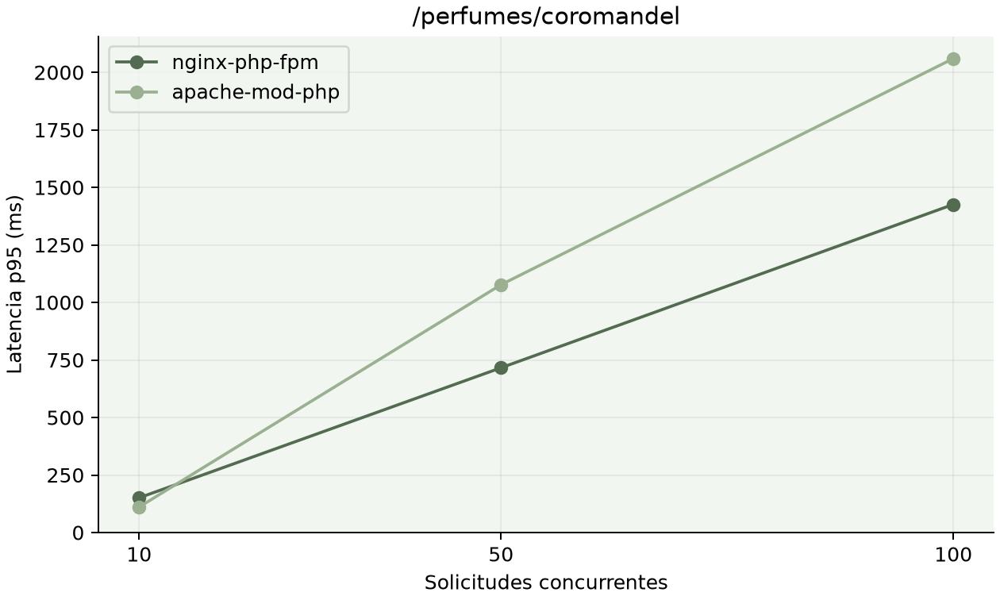

# Benchmark de arquitecturas · 9 de noviembre de 2026

## Entorno

AMD Ryzen 5 5500 (6 núcleos, 12 hilos), 16 624 160 768 bytes RAM (~15,48 GiB), Docker 29.1.3 sobre Linux 7.0.0-38-generic, una sola máquina. PHP 8.4.27 y OPcache habilitado y comprobado en ambos SAPI web. Nginx 1.31.8 + PHP-FPM frente a Apache 2.4.69 + mod_php; HAProxy 2.9.15 y MySQL 8.0. La configuración HAProxy incorpora resolución DNS Docker para recuperar direcciones después de stop/start. Antes de medir y al restaurar se exige ambos UP en Stats. Las versiones y los identificadores de imágenes reales están en [versiones](versiones.txt), [imágenes](imagenes.json) y [host](host.txt).

Se mantienen las configuraciones del stack: PHP-FPM `pm=dynamic`, `pm.max_children=5`; Apache prefork `MaxRequestWorkers=150`, StartServers=5. Sin cuotas equivalentes de CPU/RAM por arquitectura. Esta es una comparación de esos despliegues, no una demostración de superioridad universal de un servidor.

## Metodología y reproducción

Ejecutar desde la raíz `sg docker -c './docker/scripts/benchmark.sh'`. Requiere Bash, Python3 y Docker; no instala generadores de carga en el host. `BENCHMARK_REQUESTS` ajusta el número de solicitudes por punto (mínimo100; valor predeterminado2000). `BENCHMARK_OUTPUT` cambia la carpeta de salida. La corrida reemplaza los resultados de esa carpeta.

Se eligió **ApacheBench 2.3 de httpd:2.4.65-alpine**, una imagen con versión fija, por sus contadores y percentiles sin instalar nada en el host. Se ejecuta como servicio de perfil `benchmark` dentro de la red Compose; los nodos no publican puertos. Los parámetros comunes son `-l -r -s 60 -n 2000`, concurrencias10/50/100, sin keepalive. `-l` evita contar como fallo las diferencias de longitud del HTML dinámico (por ejemplo tokens de sesión); no elimina los errores de conexión ni las respuestas no2xx. [Referencia oficial de ApacheBench](https://httpd.apache.org/docs/2.4/programs/ab.html).

Laravel se prepara con APP_ENV=production y APP_DEBUG=false, config:cache, route:cache y view:cache, compartidos por los nodos. Se hacen30 solicitudes de calentamiento por endpoint/nodo, descartadas de las tablas. Se midió primero Nginx y después Apache, siempre /up, catálogo, ficha Coromandel y el mismo CSS compilado. No se usan cookies ni login. GET con sesiones y caché database puede escribir datos operativos; no se ejecutaron migraciones, seeders ni modificaciones de stock, productos o pedidos.

Cada fila usa RPS de ab, latencia media de la fila Total (ms), percentiles50/95/99 y errores=Failed requests + Non-2xx responses (no es necesariamente un conteo único si una respuesta cae en ambas categorías). La salida original, incluidos calentamientos, se conserva en [resultados/](resultados/); el [CSV consolidado](resultados.csv) mantiene los números emitidos por ab. Los percentiles de ab se imprimen en milisegundos enteros; no se inventa precisión adicional.

La restauración siempre intenta iniciar web-nginx y limpiar configuración, rutas y vistas compiladas, incluso ante errores o interrupciones. No cambia .env ni APP_KEY. Regresa al entorno local de desarrollo, con ambos nodos activos.

## Resultados directos

### /up

| Arquitectura | Concurrencia | RPS | Media ms | p50 ms | p95 ms | p99 ms | Errores / solicitudes |
|---|---:|---:|---:|---:|---:|---:|---:|
| nginx-php-fpm | 10 | 305.81 | 33.0 | 29.0 | 49.0 | 69.0 | 0 / 2000 |
| nginx-php-fpm | 50 | 341.4 | 144.0 | 145.0 | 156.0 | 162.0 | 0 / 2000 |
| nginx-php-fpm | 100 | 321.95 | 302.0 | 298.0 | 361.0 | 369.0 | 0 / 2000 |
| apache-mod-php | 10 | 429.02 | 23.0 | 23.0 | 28.0 | 32.0 | 0 / 2000 |
| apache-mod-php | 50 | 435.27 | 114.0 | 108.0 | 171.0 | 217.0 | 0 / 2000 |
| apache-mod-php | 100 | 424.73 | 232.0 | 182.0 | 563.0 | 721.0 | 0 / 2000 |

### /perfumes

| Arquitectura | Concurrencia | RPS | Media ms | p50 ms | p95 ms | p99 ms | Errores / solicitudes |
|---|---:|---:|---:|---:|---:|---:|---:|
| nginx-php-fpm | 10 | 58.25 | 171.0 | 169.0 | 191.0 | 203.0 | 0 / 2000 |
| nginx-php-fpm | 50 | 57.59 | 856.0 | 862.0 | 913.0 | 947.0 | 0 / 2000 |
| nginx-php-fpm | 100 | 56.97 | 1709.0 | 1744.0 | 1809.0 | 1838.0 | 0 / 2000 |
| apache-mod-php | 10 | 79.44 | 125.0 | 125.0 | 140.0 | 149.0 | 0 / 2000 |
| apache-mod-php | 50 | 80.82 | 613.0 | 540.0 | 1273.0 | 1495.0 | 0 / 2000 |
| apache-mod-php | 100 | 81.57 | 1209.0 | 1059.0 | 2626.0 | 2986.0 | 0 / 2000 |

### /perfumes/coromandel

| Arquitectura | Concurrencia | RPS | Media ms | p50 ms | p95 ms | p99 ms | Errores / solicitudes |
|---|---:|---:|---:|---:|---:|---:|---:|
| nginx-php-fpm | 10 | 72.94 | 136.0 | 135.0 | 151.0 | 166.0 | 0 / 2000 |
| nginx-php-fpm | 50 | 72.4 | 681.0 | 685.0 | 716.0 | 744.0 | 0 / 2000 |
| nginx-php-fpm | 100 | 72.0 | 1352.0 | 1383.0 | 1426.0 | 1456.0 | 0 / 2000 |
| apache-mod-php | 10 | 100.76 | 99.0 | 99.0 | 111.0 | 122.0 | 0 / 2000 |
| apache-mod-php | 50 | 103.26 | 479.0 | 423.0 | 1077.0 | 1266.0 | 0 / 2000 |
| apache-mod-php | 100 | 102.58 | 961.0 | 868.0 | 2060.0 | 2416.0 | 0 / 2000 |

### /build/assets/app-DUsGpcYZ.css

| Arquitectura | Concurrencia | RPS | Media ms | p50 ms | p95 ms | p99 ms | Errores / solicitudes |
|---|---:|---:|---:|---:|---:|---:|---:|
| nginx-php-fpm | 10 | 8105.07 | 1.0 | 1.0 | 1.0 | 1.0 | 0 / 2000 |
| nginx-php-fpm | 50 | 8301.96 | 6.0 | 6.0 | 6.0 | 7.0 | 0 / 2000 |
| nginx-php-fpm | 100 | 8565.42 | 11.0 | 12.0 | 13.0 | 14.0 | 0 / 2000 |
| apache-mod-php | 10 | 7801.19 | 1.0 | 1.0 | 1.0 | 2.0 | 0 / 2000 |
| apache-mod-php | 50 | 7866.43 | 6.0 | 6.0 | 7.0 | 7.0 | 0 / 2000 |
| apache-mod-php | 100 | 7712.36 | 13.0 | 13.0 | 14.0 | 15.0 | 0 / 2000 |

## Gráficos

Generados mediante `python3 -I docs/benchmark/graficos.py` (en esta máquina con `/tmp/mar-benchmark-venv/bin/python -I`, matplotlib3.11.2 en venv temporal). Paleta salvia; escala lineal con cero.

## HAProxy y caída bajo carga

| Escenario | Concurrencia | RPS | Media ms | p95 ms | p99 ms | Errores / solicitudes |
|---|---:|---:|---:|---:|---:|---:|
| haproxy | 50 | 78.32 | 626.0 | 1163.0 | 1212.0 | 0 / 2000 |
| haproxy-failover | 50 | 63.55 | 757.0 | 3174.0 | 5079.0 | 0 / 954 |

La corrida normal utiliza2000 solicitudes. La variante de failover usa `-t 15 -n 1000000` (límite de15 segundos) para que la carga siga activa mientras se detiene nginx durante3 segundos y se reinicia; no tiene igual número de solicitudes y no se presenta como una comparación A/B de carga fija. La caída se inicia solo después de observar aumento de sesiones por servidor en Stats y confirmar que el generador sigue activo. La restauración conserva el nodo aunque falle la prueba. Dos ensayos iniciales de failover se descartaron (uno sin barrera de inicio y otro con Nginx previamente DOWN por una IP Docker cambiada): sus salidas crudas se conservan con prefijo descartado y no se usa en el CSV consolidado ni en estas conclusiones. HAProxy usa fall3/rise2/inter2s; puede seguir marcando A disponible durante parte de la caída y reasignar conexiones fallidas.

### Tráfico real en Stats

Snapshots completos de `http://haproxy:8404/;csv`, con autenticación admin, guardados antes de la corrida y tras normal/failover. La tabla son diferencias de contadores por servidor (stot, bin y bout), no valores absolutos históricos. Consultar `http://localhost:8404/` para ver el dashboard activo.

| Fase | Servidor | Δ sesiones stot | Δ bytes entrada | Δ bytes salida | Estado al snapshot |
|---|---|---:|---:|---:|---|
| Normal | nginx-php-fpm | 1000 | 86000 | 181874000 | UP |
| Normal | apache-mod-php | 1000 | 86000 | 181904000 | UP |
| Failover | nginx-php-fpm | 539 | 36034 | 75905771 | UP |
| Failover | apache-mod-php | 543 | 46526 | 98006528 | UP |

## Conclusiones

- /up, concurrencia50: Nginx 341.4 RPS y p95 156.0ms; Apache 435.27 RPS y p95 171.0ms.
- /perfumes, concurrencia50: Nginx 57.59 RPS y p95 913.0ms; Apache 80.82 RPS y p95 1273.0ms.
- /perfumes/coromandel, concurrencia50: Nginx 72.4 RPS y p95 716.0ms; Apache 103.26 RPS y p95 1077.0ms.

En HAProxy normal se completaron2000 solicitudes a78.32 RPS, con0 errores y1000 sesiones por servidor en Stats. En failover se completaron954 solicitudes a63.55 RPS con0 errores; el p95 subió de1163 a3174ms y el p99 de1212 a5079ms. La disponibilidad se conservó con un costo observable de latencia. Ambos servidores terminaron UP, respaldados por stats-final.csv. Los contadores de sesiones de failover pueden superar las solicitudes completadas por reintentos de conexión.

El resultado depende de los límites de procesos y del costo de Laravel/SQL; aumentar concurrencia puede aumentar la cola y la latencia sin aumentar proporcionalmente el throughput. En los puntos donde una arquitectura logra más RPS pero peor p95/p99 no hay una ganadora en todos los criterios: throughput y latencia de cola describen aspectos distintos. Los datos de archivos estáticos no representan el trabajo PHP ni SQL. El escenario con balanceador añade distribución entre ambas configuraciones, no permite sumar automáticamente los RPS directos. Los errores y percentiles se reportan tal como aparecieron, sin descartar los puntos desfavorables.

## Limitaciones y pendientes

Una sola corrida por punto, en orden fijo, sin intervalos de confianza ni aleatorización. Una máquina compartida para servidores, MySQL y generador; CPU, memoria, caché del SO y estado de conexiones cambian durante el ensayo. El generador y el arranque de contenedores consumen recursos; el RPS de ab excluye el tiempo de arrancar su contenedor. El failover es una caída controlada breve, no una prueba prolongada de disponibilidad. Sin TLS, red externa, usuarios autenticados ni prueba de continuidad de carrito/sesión. No incluye Portainer ni garantiza rendimiento de producción. Las pruebas estáticas de2000 solicitudes duran una fracción de segundo y son especialmente sensibles al ruido; no permiten afirmar diferencias pequeñas como concluyentes. El warm-up es pequeño y Apache prefork puede seguir aumentando procesos al comenzar una concurrencia mayor.
