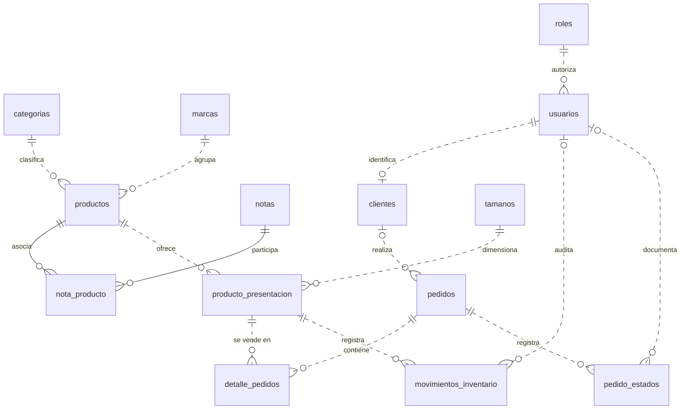
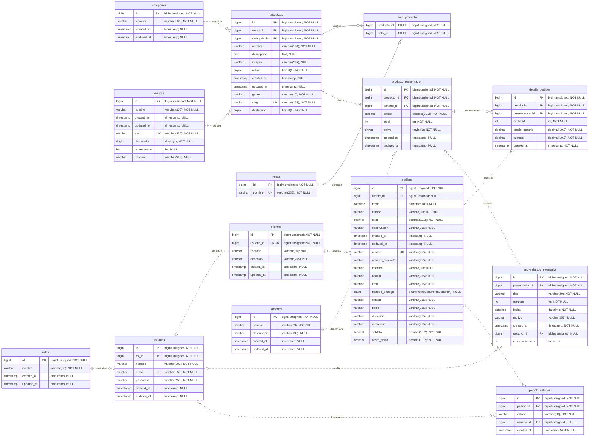

# Modelo entidad-relación de Mar Fragancias

Fuente: 20 migraciones aplicadas e introspección MySQL 8.0.46 de la misma base que el [diccionario](diccionario-de-datos.md). Se representan las 14 tablas de negocio y sus 15 FK reales; las 8 tablas operativas se explican aparte en el diccionario. No se dibuja password_reset_tokens porque no existe.

## Nivel conceptual

Entidades y relaciones sin atributos; se conservan las asociaciones explícitas para que se pueda trazar cada entidad al esquema.



## Nivel lógico

Los tipos de las etiquetas son familias MySQL; el comentario de cada atributo conserva el tipo exacto (longitud, precisión, unsigned o enum) y su nulabilidad. PK indica clave primaria, FK clave foránea y UK una unicidad individual. nota_producto tiene una sola PK compuesta (producto_id, nota_id), no dos claves independientes. Producto_presentacion tiene PK id, sin UNIQUE(producto_id,tamano_id).



## Lectura de las cardinalidades

- `||`: exactamente uno; `|o`/`o|`: cero o uno; `o{`: cero o muchos. Se representan posibilidades permitidas por las FK y sus índices, no conteos de los datos de muestra.
- Cada cliente exige un usuario y cada usuario admite cero o un cliente (usuario_id UNIQUE). Cada usuario exige un rol; un rol puede tener cero o muchos usuarios.
- Cada pedido puede no tener cliente (compra invitada); un cliente puede tener cero o muchos pedidos. No es una relación obligatoria del lado del pedido.
- pedido_estados y movimientos_inventario pueden no tener usuario auditor por sus FK nullable. Cada fila sí exige el pedido o la presentación correspondiente.
- Cada presentación exige producto y tamaño; ambos pueden tener cero o muchas presentaciones. La base NO garantiza que el par producto/tamaño sea único.
- Cada ítem exige pedido y presentación; la base permite un pedido sin ítems, aunque el checkout no lo genera. Del mismo modo, los pedidos históricos pueden no tener historial.
- Producto y nota son muchos a muchos mediante nota_producto; cada fila de la asociación exige ambos. Solo esas dos FK tienen ON DELETE CASCADE. Las otras 13 FK tienen ON DELETE/UPDATE NO ACTION. Ver nombres exactos en el diccionario.
- Línea sólida: FK que participa de la PK compuesta de nota_producto (relación identificante). Línea discontinua: relación no identificante en tablas con PK propia id.

Las relaciones polimórficas de personal_access_tokens y sessions.user_id no son FK SQL y no se añaden al DER de negocio. En particular, no se inventa una tabla users: la cuenta real está en usuarios.

## Versión para presentación

[DER lógico en SVG](der-logico.svg), exportado desde el bloque lógico anterior. SVG permite ampliar sin perder legibilidad; el diagrama completo es grande y no sustituye la lectura por entidades del diccionario.

### Exportación reproducible

El archivo SVG se generó con Mermaid CLI **11.12.0** y Node **24.22.0**. Extraer el contenido del segundo bloque Mermaid (nivel lógico) a `/tmp/mar-der-logico.mmd` y ejecutar:

```bash
PATH="$HOME/.local/bin:$PATH" npx --yes @mermaid-js/mermaid-cli@11.12.0 \
  -i /tmp/mar-der-logico.mmd -o docs/datos/der-logico.svg -b white
```

La ruta `~/.local/node/bin` indicada en el plan no existe en esta máquina; se usó el Node instalado en `~/.local/bin` (ejecutable real en `~/.local/lib/nodejs/node-v24.22.0-linux-x64/bin/node`). Chromium no pudo arrancar con sandbox por la política de namespaces del host. Para esta exportación de un archivo local se utilizó un JSON temporal de Puppeteer con `{"args":["--no-sandbox"]}` y la opción `-p /tmp/mar-mermaid-puppeteer.json`; no se cambiaron políticas del sistema ni el runtime de la aplicación. El SVG sí fue exportado, no es una captura ni un diagrama inventado.
